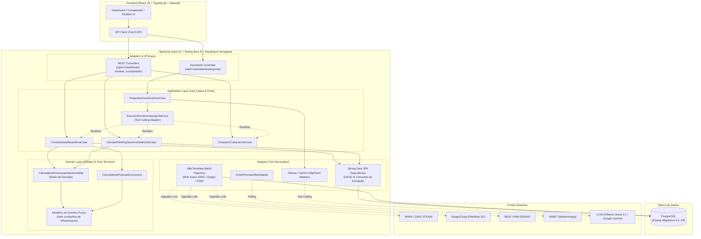

# Agro Tool 🌱

> **Plataforma inteligente de recomendação e suporte à tomada de decisão de plantio para produtores rurais de Santa Catarina.**

> [!NOTE]
> **Status do Projeto — Versão MVP (Produto Mínimo Viável)**  
> O **Agro Tool** encontra-se atualmente em fase de **MVP**, atendendo inicialmente o estado de Santa Catarina. O projeto está em desenvolvimento ativo: novas funcionalidades, melhorias contínuas na experiência do usuário, expansão de bases públicas e refinamentos no motor de decisão agronômica serão continuamente incorporados ao longo dos próximos ciclos.

O **Agro Tool** transforma dados públicos dispersos e complexos (zoneamento climático oficial, cotações regionais de mercado, séries históricas de produção agrícola e condições meteorológicas em tempo real) em recomendações práticas e fundamentadas para o agricultor decidir o que, quando e como plantar.

---

## 🎯 O que o Agro Tool Resolve?

A tomada de decisão no campo envolve riscos elevados. Decidir o cultivo apenas com base no preço atual da saca pode induzir a erros graves, pois desconsidera riscos climáticos, janelas de semeadura, capacidade hídrica do solo e histórico de produtividade local.

O Agro Tool responde a cinco perguntas essenciais do produtor rural:

1. **O que posso plantar no meu município?** — Avaliação de aptidão agroclimática oficial via ZARC.
2. **Qual cultura apresenta as melhores oportunidades?** — Score multicritério balanceando risco, preços e produtividade.
3. **Quando devo plantar?** — Matriz decendial de plantio (1 a 36 decêndios) e janelas ideais por tipo de solo e ciclo.
4. **Qual é o preço atual de comercialização?** — Cotações de referência da praça regional vinculada (Epagri/Cepa).
5. **Quais culturas merecem atenção ou comparação direta?** — Análise aprofundada e comparador multicultura lado a lado.

### Jornada do Produtor

```text
[ Informar Município, Período e Área ]
                 │
                 ▼
       [ Culturas Possíveis ]  ── (Aptidão climática oficial ZARC)
                 │
                 ▼
    [ Ranking de Oportunidades ]  ── (Cruzamento de risco + mercado Epagri + PAM)
                 │
        ┌────────┴────────┐
        ▼                 ▼
[ Análise da Cultura ]  [ Comparador Lado a Lado ]
        │                 │
        └────────┬────────┘
                 ▼
 [ Assistente IA Consultivo ]  ── (Esclarecimento de dúvidas via Tool Calling)
```

---

## 💡 Principais Funcionalidades

- **Dashboard Integrado de Oportunidades**: Visão consolidada para os 295 municípios de Santa Catarina com ranking ponderado de culturas, indicadores de risco e destaques de mercado.
- **Matriz Decendial ZARC (Decêndios 1 a 36)**: Calendário agronômico anual dividido em períodos de 10 dias, identificando janelas de semeadura seguras (risco de 20%, 30% ou 40%) conforme a retenção hídrica do solo (AD1, AD2, AD3) e ciclos da cultivar.
- **Histórico & Dinâmica de Preços**: Gráficos temporais de cotações regionais fornecidas pela Epagri/Cepa, com análise de tendência e variação percentual.
- **Estação Meteorológica em Tempo Real**: Monitoramento de temperatura, umidade, vento e pressão conectando-se a dados do INMET.
- **Comparador Multicultura**: Análise simultânea de até três culturas comparando risco mínimo, decêndios favoráveis, preços e projeção de receita.
- **Modal Analítico Completo**: Ficha técnica com abas dedicadas para Zoneamento, Dinâmica de Mercado e Motor de Decisão / Projeção Econômica.
- **Assistente IA Consultivo**: Chatbot integrado capaz de responder dúvidas agroclimáticas invocando as ferramentas do backend em tempo real.

---

## 🚀 Status do MVP & Evolução Contínua

O **Agro Tool** é um projeto vivo e está em fase de **Produto Mínimo Viável (MVP)**. A espinha dorsal da plataforma já está plenamente operacional para os 295 municípios de Santa Catarina, integrando dados climáticos (ZARC), preços de comercialização (Epagri/Cepa), histórico de produção (PAM/IBGE) e monitoramento meteorológico (INMET).

Como parte de sua evolução contínua, novos recursos e refinamentos estão sendo acrescentados:
- **Novas Bases e Refinamentos Econômicos**: Incorporação de dados detalhados de custos de produção agrícola para projeções de margem líquida e rentabilidade real por hectare.
- **Calibração do Motor de Decisão**: Aprimoramento contínuo dos pesos de pontuação com validações e parâmetros agronômicos aprofundados.
- **Aperfeiçoamento da Inteligência Artificial**: Expansão do repertório de ferramentas (Tool Calling) e enriquecimento do contexto conversacional do produtor.
- **Expansão Territorial Futura**: Planejamento para suporte a outros estados e polos do agronegócio nacional.

---

## 🏛️ Arquitetura do Sistema

O projeto adota uma arquitetura em **Monólito Modular** no backend com padrão **Hexagonal (Ports and Adapters)**, garantindo desacoplamento estrito entre as regras de negócio centrais, fontes de dados e protocolos de comunicação.



---

## ⚖️ Decisões Arquiteturais (ADRs)

### 1. Monólito Modular vs Microsserviços
Para a fase de MVP com escopo regional (Santa Catarina), a escolha de um monólito modular elimina a latência de rede entre domínios, simplifica a orquestração transacional e agiliza a evolução dos modelos de dados sem a sobrecarga operacional de microsserviços.

### 2. Persistência Híbrida: JPA + JdbcTemplate
- **Spring Data JPA / Hibernate**: Utilizado para consultas transacionais, leitura de agregados e navegação relacional na API.
- **JdbcTemplate (Batch Operations)**: A base do ZARC e os históricos de cotações totalizam dezenas de milhares de registros. Carregar esses dados via ORM tradicional geraria pressão severa no Garbage Collector e latência excessiva. As rotinas de ingestão utilizam `JdbcTemplate` com operações em lote e `reWriteBatchedInserts=true`, alcançando alta taxa de transferência com baixo consumo de memória.
- **Versionamento com Flyway**: Toda a estrutura e dados mestres são versionados em scripts SQL migráveis (`V1` a `V5`).

### 3. Motor de Decisão: Preço Alto ≠ Maior Rentabilidade
O ranking de oportunidades calcula uma pontuação ponderada de 0 a 100 com base em múltiplos critérios objetivos:
- **Segurança Climática**: Nível de risco ZARC (riscos de 20% pontuam mais alto que 30% ou 40%).
- **Amplitude da Janela de Semeadura**: Quantidade de decêndios agronomicamente favoráveis no período de interesse.
- **Dinâmica e Comportamento de Mercado**: Comportamento e tendência recente dos preços na praça Epagri.
- **Potencial Produtivo / Econômico**: Produtividade histórica municipal obtida da base PAM/IBGE (quando disponível área e dados históricos suficientes).
- **Qualidade e Confiabilidade da Informação**: Presença de cotações locais vs regionais e histórico de dados.

### 4. Assistente de IA com Function Calling / Tool Calling
O assistente de linguagem natural atua estritamente como agente consultivo de apoio à interpretação:
- Não tem permissão para executar comandos SQL ou navegar arbitrariamente no banco de dados.
- Não duplica nem recalcula as regras do motor de decisão.
- Realiza **Tool Calling** invocando diretamente os Casos de Uso da aplicação (`consultar_zoneamento_municipio`, `calcular_ranking_oportunidades`, `consultar_analise_cultura`, `comparar_culturas`).
- Suporta múltiplos provedores: **Ollama** (Llama 3.1 local) para execução sem custos de nuvem e **Google Gemini** para alta capacidade de raciocínio contextual.

---

## 🌐 Fontes de Dados Públicas Integradas

| Fonte | Responsável | Conteúdo no Agro Tool |
|---|---|---|
| **ZARC** | Ministério da Agricultura e Pecuária (MAPA) | Calendário decendial de risco climático (20%, 30%, 40%), tipos de solo (AD1, AD2, AD3), ciclos de cultivares e portarias oficiais por município. |
| **Epagri/Cepa** | Centro de Socioeconomia e Planejamento Agrícola de SC | Cotações agropecuárias médias por praça de comercialização, frequências diárias e semanais, nomes comerciais e especificações. |
| **PAM** | Instituto Brasileiro de Geografia e Estatística (IBGE) | Pesquisa Agrícola Municipal via API SIDRA: histórico de área plantada, área colhida, quantidade produzida e rendimento médio (kg/ha). |
| **INMET** | Instituto Nacional de Meteorologia | Estações meteorológicas automáticas, temperatura, umidade relativa, velocidade do vento e pressão atmosférica. |

---

## 🛠️ Stack Tecnológica

### Backend
- **Linguagem**: Java 21 (LTS)
- **Framework**: Spring Boot 4.1.2
- **Módulos Spring**: Spring WebMVC, Spring Data JPA, Spring Security, Spring Validation, Spring Actuator
- **Banco de Dados**: PostgreSQL 15+ com driver JDBC nativo
- **Migrações**: Flyway Database Migration
- **Manipulação de Planilhas**: Apache POI 5.4 (ingestão de planilhas `.xlsx` da Epagri)
- **Serialização**: Jackson Databind
- **Produtividade**: Project Lombok

### Frontend
- **Framework & Runtime**: React 19.3 com TypeScript e Vite 8.3
- **Estilização**: Tailwind CSS com plugins PostCSS e Autoprefixer
- **Visualização de Dados**: Recharts (gráficos temporais interativos)
- **Ícones**: Lucide React
- **Renderização Rica**: React Markdown
- **Linter**: Oxlint

### Inteligência Artificial
- **Ollama**: Suporte a modelos locais (ex: `llama3.1`)
- **Google Gemini**: Suporte a modelos em nuvem (`gemini-1.5-flash`)
- **Protocolo**: Chamada de funções estruturadas (*Function Calling / Tool Calling*) via HTTP

---

## 📁 Estrutura de Pastas

```text
agro-tool/
├── backend/
│   ├── pom.xml
│   └── src/
│       ├── main/
│       │   ├── java/com/figueredo/ricardo/mvp/
│       │   │   ├── assistente/     # Orquestração do assistente de IA, prompts e Tool Calling
│       │   │   ├── clima/          # Integração meteorológica com INMET
│       │   │   ├── common/         # Segurança, tratamento global de exceções e DTOs comuns
│       │   │   ├── decisao/        # Motor de pontuação, projeção econômica, comparador e dashboard
│       │   │   ├── epagri/         # Ingestão de cotações e mapeamento de praças de mercado
│       │   │   ├── mercado/        # Consulta agregada de preços e histórico de produtos
│       │   │   ├── pam/            # Ingestão e agregação histórica da PAM/IBGE (SIDRA)
│       │   │   └── zarc/           # Ingestão e consultas de zoneamento de risco climático
│       │   └── resources/
│       │       ├── application.yaml
│       │       └── db/migration/   # Scripts versionados Flyway (V1..V5)
│       └── test/                   # Testes unitários e de integração
│
└── frontend/
    ├── package.json
    ├── vite.config.ts
    ├── tailwind.config.js
    └── src/
        ├── api/                    # Cliente HTTP e catálogo de endpoints
        ├── assets/                 # Recursos gráficos e logos
        ├── components/
        │   ├── analise/            # Modal analítico e ficha técnica da cultura
        │   ├── common/             # Header, Chatbot flutuante, seletores e badges
        │   ├── comparador/         # Tabela de comparação lado a lado
        │   ├── culturas/           # Grid de culturas e Matriz Decendial ZARC
        │   ├── dashboard/          # Cards meteorológicos, gráficos e ranking
        │   └── solos/              # Modal explicativo dos tipos de solo (AD1..AD3)
        ├── context/                # Contexto global de filtros de consulta
        ├── types/                  # Tipagens TypeScript da API
        └── utils/                  # Formatadores de moeda, datas e validadores
```

---

## 🚀 Como Executar o Projeto

### Pré-requisitos
- **Java 21** instalado e configurado na variável de ambiente `JAVA_HOME`.
- **Node.js** (v20+) e **npm**.
- **PostgreSQL** (v15+) ativo.
- *(Opcional)* **Ollama** executando localmente (`ollama run llama3.1`) ou chave de API do **Google Gemini**.

---

### 1. Configuração do Banco de Dados PostgreSQL

Crie a base de dados no PostgreSQL:

```sql
CREATE DATABASE agro_tool;
```

---

### 2. Configuração e Execução do Backend

No diretório `backend`, defina as variáveis de ambiente necessárias ou utilize os padrões configurados em `src/main/resources/application.yaml`:

```bash
# Variáveis de ambiente opcionais (valores padrão entre colchetes)
export DB_HOST=localhost
export DB_PORT=5432
export DB_NAME=agro_tool
export DB_USERNAME=seu_usuario
export DB_PASSWORD=sua_senha

# Configuração de IA (padrão: ollama)
export AI_PROVIDER=ollama
export OLLAMA_BASE_URL=http://localhost:11434
export OLLAMA_MODEL=llama3.1

# Se desejar usar Gemini:
# export AI_PROVIDER=gemini
# export GEMINI_API_KEY=sua_chave_aqui
```

Execute a aplicação Spring Boot:

```bash
cd backend
./mvnw spring-boot:run
```

O Flyway aplicará automaticamente todas as migrações (`V1` a `V5`), preparando as tabelas e dados mestres (municípios catarinenses, culturas canônicas e vinculação com praças regionais). O servidor iniciará por padrão na porta `8080`.

---

### 3. Configuração e Execução do Frontend

No diretório `frontend`:

```bash
cd frontend

# Instalar as dependências
npm install

# Iniciar o servidor de desenvolvimento
npm run dev
```

Acesse no navegador: **`http://localhost:5173`** (ou a porta indicada pelo Vite).

---

## 📡 Principais Endpoints da API REST

| Método | Endpoint | Descrição |
|---|---|---|
| `GET` | `/api/v1/municipios` | Lista municípios de SC com seus códigos IBGE e praças de referência. |
| `GET` | `/api/v1/dashboard` | Retorna o ranking de oportunidades, riscos e destaques para o município e período. |
| `GET` | `/api/v1/municipios/{codigoIbge}/culturas/{culturaId}/analise` | Retorna a análise detalhada de uma cultura (zoneamento, mercado e decisão). |
| `GET` | `/api/v1/comparador` | Compara indicadores de 2 a 3 culturas para o município informado. |
| `GET` | `/api/v1/clima/atual/{codigoIbge}` | Retorna as condições climáticas e meteorológicas atuais via INMET. |
| `POST` | `/api/v1/assistente/perguntar` | Envia perguntas em linguagem natural para o assistente consultivo de IA. |
| `POST` | `/api/v1/jobs/zarc/executar` | Executa a rotina de download e carga dos dados abertos do ZARC/MAPA. |
| `POST` | `/api/v1/jobs/epagri/executar` | Executa a rotina de atualização dos preços agrícolas da Epagri/Cepa. |
| `POST` | `/api/v1/jobs/pam/executar` | Executa a sincronização dos dados históricos de produção agrícola (SIDRA/IBGE). |

---

## 🧪 Testes

Para executar os testes automatizados do backend:

```bash
cd backend
./mvnw test
```

A suíte abrange testes unitários e de integração para os casos de uso, motor de decisão multicritério, cálculos de projeção econômica e mappers de persistência.

---

## 📄 Licença

Este projeto é desenvolvido para fins de apoio ao agronegócio e modernização da tomada de decisão rural.
